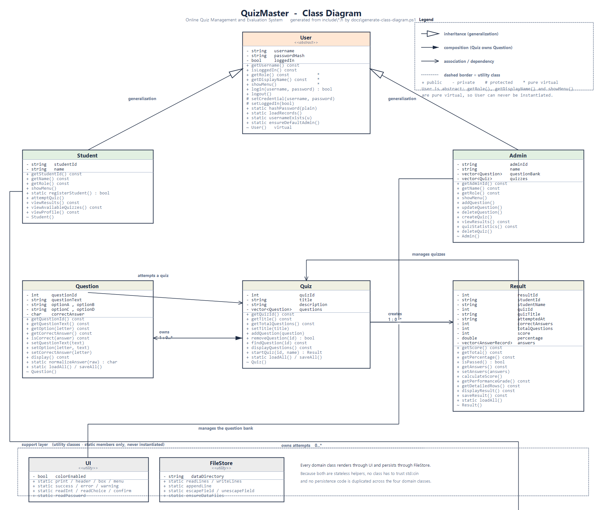

# QuizMaster

### Online Quiz Management and Evaluation System

A console based quiz platform written in **C++** for the Object Oriented Programming
subject (TAE-2). It lets students register, attempt quizzes and see their results,
while an administrator authors questions, composes quizzes and studies the results.

---

## Table of Contents

1. [Project Overview](#project-overview)
2. [Problem Statement](#problem-statement)
3. [Objectives](#objectives)
4. [Features](#features)
5. [Technology Used](#technology-used)
6. [OOP Concepts Demonstrated](#oop-concepts-demonstrated)
7. [System Modules](#system-modules)
8. [Class Diagram](#class-diagram)
9. [Project Structure](#project-structure)
10. [How to Compile](#how-to-compile)
11. [How to Run](#how-to-run)
12. [Default Login Credentials](#default-login-credentials)
13. [Sample Data Shipped With the Project](#sample-data-shipped-with-the-project)
14. [Sample Student Flow](#sample-student-flow)
15. [File Formats](#file-formats)
16. [Input Validation Rules](#input-validation-rules)
17. [Testing](#testing)
18. [Team Members](#team-members)
19. [Limitations](#limitations)
20. [Future Enhancements](#future-enhancements)

The use case diagram and the full class diagram description live in
[`docs/use-case.md`](docs/use-case.md) and [`docs/class-diagram.md`](docs/class-diagram.md).

---

## Project Overview

QuizMaster is a self contained desktop (console) application that manages the whole
life cycle of a quiz: creating the questions, grouping them into quizzes, letting
students attempt them, evaluating the attempt automatically and reporting the outcome
to both the student and the administrator.

Everything is stored in four plain text files inside the `data/` folder, so the project
needs no database, no installation and no external libraries. Any standard C++ compiler
can build it in a single command.

## Problem Statement

Examinations that are conducted on paper, or with ad hoc spreadsheets, suffer from three
recurring problems:

* **Marking effort** - every answer sheet has to be marked by hand, which is slow and
  inconsistent between evaluators.
* **No history** - once a sheet is filed away, a student cannot see how they performed,
  and the teacher cannot analyse which topics students struggle with.
* **No content reuse** - the same questions are retyped for every revision test.

QuizMaster addresses this by separating *authoring* (admin), *attempting* (student) and
*evaluation* (automatic, immediate). A result is computed and stored the moment the last
question is answered, so it is available to both roles forever.

## Objectives

* Model the domain with clear classes instead of loose variables and functions.
* Demonstrate and *use* every core OOP concept: abstraction, encapsulation,
  inheritance, polymorphism, composition, constructors/destructors.
* Guarantee that the program never crashes, whatever the user types.
* Guarantee that no data is lost: a change is written to disk immediately and survives
  a restart.
* Keep the console interface clean and consistent, like a real product.

## Features

### Student

| Feature | Description |
|---|---|
| Registration | Self service sign-up with validation of name, username, password |
| Login / Logout | Credentials checked against `data/users.txt` (passwords are hashed) |
| Available Quizzes | Lists every published quiz with its description and length |
| Start Quiz | Interactive examination with per question feedback |
| My Results | History table with score, percentage, grade and date |
| Detailed Result | Question by question breakdown of a chosen attempt |
| My Profile | Identity data plus attempt count, passes and average score |

### Admin

| Feature | Description |
|---|---|
| Create Quiz | Creates a quiz with an automatically generated id |
| Add Question | Adds a question to the question bank, optionally straight into a quiz |
| View Questions | Table of the whole bank, showing which quiz uses each question |
| Update Question | Edits any field; the copies inside quizzes are kept in sync |
| Delete Question | Removes a question from the bank **and** from every quiz |
| Student Results | All results, filterable by student or by quiz |
| Quiz Statistics | Attempts, participants, average, highest, lowest and pass rate |
| Advanced | View quizzes, add/remove questions, delete a quiz |

### System

* Automatic persistence of every change (no "save" button anywhere).
* Graceful recovery from missing files, empty files and corrupted records.
* Optional ANSI colours that switch off automatically when the output is redirected.
* Hidden password input with `*` masking on interactive terminals.
* Command line switches: `--help`, `--no-color`, `--color`, `--data-dir <path>`.

## Technology Used

| Item | Choice |
|---|---|
| Language | C++ (compiles with `-std=c++17`, source is C++14 compatible) |
| Libraries | Standard C++ library only - no third party dependency |
| Storage | Flat files (`users.txt`, `questions.txt`, `quizzes.txt`, `results.txt`) |
| Build | Single `g++` command, plus a `Makefile` and a `build.bat` for convenience |
| Interface | Console, ASCII layout, optional ANSI colours |

## OOP Concepts Demonstrated

| Concept | Where it is used |
|---|---|
| **Abstraction** | `User` is an abstract base class: it declares `getRole()`, `getDisplayName()` and `showMenu()` as *pure virtual* functions. A `User` object cannot be created, only `Student` or `Admin`. |
| **Inheritance** | `class Student : public User` and `class Admin : public User`. Both reuse the credential handling of the base class. |
| **Polymorphism** | `main.cpp` holds a `User&` and calls `showMenu()` on it; the correct screen is chosen at run time. `std::unique_ptr<User>` deletes a `Student` through a base pointer safely because `~User()` is virtual. `User::login()` calls the virtual `getRole()` to decide which portal may use the account. |
| **Encapsulation** | Every attribute of `User`, `Student`, `Admin`, `Question`, `Quiz` and `Result` is `private`. Setters validate their argument and throw `std::invalid_argument` when it is not acceptable. |
| **Composition** | A `Quiz` owns its questions (`std::vector<Question>`); destroying the quiz destroys its questions. |
| **Aggregation / association** | A `Result` *belongs to* a student and a quiz; a student *uses* many quizzes. |
| **Constructors & destructors** | Overloaded constructors (default, full, copy) plus assignment operators and destructors for every class; the copy constructor of `Quiz` deep copies its question vector. |
| **Static members** | Shared helpers that do not need an object: `User::hashPassword()`, `Question::loadAll()`, `Quiz::nextQuizId()`, `Result::currentTimestamp()`, and all of `UI` / `FileStore`. |
| **STL containers** | `std::vector` (questions, quizzes, results, records), `std::string`, `std::map` and `std::set` (statistics), `std::unique_ptr` (ownership). |
| **File handling** | `FileStore` reads and writes records; every write goes to a temporary file first and only replaces the original after it was written successfully. |
| **Exception handling** | `std::invalid_argument` for bad input, `std::runtime_error` for I/O problems and impossible states, caught where it can be turned into a friendly message. |
| **Function overloading / default arguments** | `UI::readLine(prompt)`, `UI::count(value, singular, plural = "")`, `UI::pause(message = ...)`, `Quiz` constructors. |
| **Modular programming** | One header + one source file per class; `UI` and `FileStore` isolate cross-cutting concerns. |

### Where each concept lives (one line answers for the viva)

* **Why `User` is the base class** - because "an account with credentials and a session"
  is common to every role; only the screens differ.
* **Where polymorphism is used** - `runPortal(User&)` in `src/main.cpp` calls
  `showMenu()`, and `User::login()` calls `getRole()`.
* **Why `Quiz` contains `Question`** - a question is meaningless without the quiz it
  belongs to, and the quiz controls the order of examination, so ownership stays with
  `Quiz` (composition).
* **How the score is calculated** - `Quiz::startQuiz()` counts the correct answers and
  builds a `Result`; `Result::calculateScore()` turns that into score and percentage,
  `Result::getPerformanceGrade()` turns the percentage into a grade.
* **How data survives a restart** - every modification is written immediately through
  `FileStore::writeLines()` / `appendLine()`, and the data is read back at start-up.

## System Modules

| Module | Responsibility |
|---|---|
| `main.cpp` | Start-up, command line, main menu, polymorphic portal dispatch, About screen |
| `User` | Abstract base class: credentials, login/logout, hashing, `users.txt` |
| `Student` | Registration, dashboard, quiz attempts, personal results |
| `Admin` | Question bank, quiz authoring, reports and statistics |
| `Quiz` | Composition of questions, serialisation, the interactive quiz engine |
| `Question` | One multiple choice item, serialisation, answer checking |
| `Result` | Scoring, grading, per question breakdown, `results.txt` |
| `FileStore` | Paths, record escaping, safe read/write of the flat files |
| `UI` | Colours, boxes, tables, and *all* validated input |

### File format

Every data file holds one record per line, fields separated by `|`, and every field is
escaped (`\` becomes `\\`, `|` becomes `\|`) so that any text the user types is safe.

```
USER|STUDENT|STU001|Rohan Verma|rahul|056166D3B1894D8F
Q|1|Which OOP principle hides data?|Inheritance|Encapsulation|Polymorphism|Abstraction|B
QUIZ|1|C++ OOP Fundamentals|Description of the quiz|5
RESULT|1|STU001|Rohan Verma|1|C++ OOP Fundamentals|3|5|2026-10-01 10:15|1:B:B,2:C:C,...
```

A `QUIZ` header line is always followed by the question lines of that quiz; the last
field of the header declares how many should follow, and a mismatch is reported as a
warning instead of losing data.

## Class Diagram



The same diagram in editable form:

* `docs/class-diagram.mmd` - Mermaid source (render on mermaid.live or GitHub)
* `docs/class-diagram.md` - the diagram as text plus the relationship description

Relationships implemented in the code:

| From | To | Relationship |
|---|---|---|
| `Student` | `User` | inheritance (`public`) |
| `Admin` | `User` | inheritance (`public`) |
| `Quiz` | `Question` | composition, `1` to `0..*` |
| `Quiz` | `Result` | creates, `1` to `0..*` |
| `Result` | `Student`, `Quiz` | association (references by id and name) |
| `Admin` | `Quiz`, `Question`, `Result` | manages / reports on |
| `Student` | `Quiz`, `Result` | attempts / owns attempts |

## Project Structure

```
QuizMaster/
├── README.md                  <- you are reading this
├── TEAM_CONTRIBUTION.md       <- who wrote which file
├── .gitignore
├── Makefile                   <- "make" builds the project
├── build.bat                  <- double click build on Windows
├── include/                   <- class declarations
│   ├── User.h
│   ├── Student.h
│   ├── Admin.h
│   ├── Quiz.h
│   ├── Question.h
│   ├── Result.h
│   ├── UI.h
│   └── FileStore.h
├── src/                       <- class implementations
│   ├── main.cpp
│   ├── User.cpp
│   ├── Student.cpp
│   ├── Admin.cpp
│   ├── Quiz.cpp
│   ├── Question.cpp
│   ├── Result.cpp
│   ├── UI.cpp
│   └── FileStore.cpp
├── data/                      <- created / refreshed automatically
│   ├── users.txt
│   ├── questions.txt
│   ├── quizzes.txt
│   └── results.txt
├── docs/
│   ├── class-diagram.png
│   ├── class-diagram.mmd
│   ├── class-diagram.md
│   ├── use-case.md
│   ├── generate-class-diagram.ps1
│   ├── run-tests.ps1
│   └── TEST_REPORT.md
├── screenshots/
│   ├── README.md
│   ├── student-flow.txt
│   └── admin-flow.txt
└── build/                     <- compiler output (ignored by git)
```

## How to Compile

The project has **no dependencies**, so one command is enough.

### Linux / macOS

```bash
g++ -std=c++17 src/*.cpp -Iinclude -o QuizMaster
```

### Windows (MinGW-w64 / MSYS2)

```bash
g++ -std=c++17 src/*.cpp -Iinclude -o QuizMaster.exe
```

### Windows without a Unix shell

PowerShell does not expand `src/*.cpp`, so list the files explicitly:

```powershell
g++ -std=c++17 -Iinclude src\main.cpp src\UI.cpp src\FileStore.cpp src\User.cpp `
    src\Student.cpp src\Admin.cpp src\Quiz.cpp src\Question.cpp src\Result.cpp `
    -o build\QuizMaster.exe
```

or simply run `build.bat`, or `make` if `mingw32-make` is on your PATH.

### Compiler flags used while developing

```bash
g++ -std=c++17 -Wall -Wextra -Wpedantic -Iinclude src/*.cpp -o QuizMaster
```

The code compiles **without a single warning**.

> The sources deliberately stay inside C++14/17 features that every compiler supports
> (`std::filesystem`, `if constexpr` and structured bindings are *not* used), so the
> project also builds on older MinGW installations.

## How to Run

Run the executable **from the project root**, because the `data/` folder is looked up
relative to the working directory:

```bash
./QuizMaster
```

Useful switches:

```bash
./QuizMaster --help              # usage information
./QuizMaster --no-color          # plain text output (useful for reports or piping)
./QuizMaster --data-dir mydata   # keep the data files somewhere else
```

## Default Login Credentials

| Role | Username | Password | Name |
|---|---|---|---|
| Admin | `admin` | `admin123` | System Administrator |
| Student | `rahul` | `rahul123` | Rohan Verma (STU001) |
| Student | `priya` | `priya123` | Priya Nair (STU002) |

Notes:

* Passwords are **never stored in plain text**. `User::hashPassword()` produces a
  64 bit FNV-1a hash which is what you see in `data/users.txt`. The values above were
  generated by the program itself, which is why they are guaranteed to match.
* The administrator account is *initial configuration*: if `data/users.txt` contains no
  admin record at all, `User::ensureDefaultAdmin()` creates `admin / admin123` on start-up
  and prints a warning. No student account is ever hard coded in the source.

## Sample Data Shipped With the Project

The repository already contains working sample data so the application is never empty:

* 1 administrator and 2 students,
* **14 questions** in the question bank (7 on OOP, 7 on databases),
* **2 published quizzes**: *C++ OOP Fundamentals* and *Database Management Basics*
  (5 questions each), so 4 bank questions are free for the admin to experiment with,
* **5 historical results** with a full per question breakdown.

## Sample Student Flow

```
QuizMaster                     -> 1 (Student)
STUDENT PORTAL                 -> 2 (Login) -> rahul / rahul123
STUDENT DASHBOARD              -> 1 (Available Quizzes)
                               -> Y, 1  (see the description)
                               -> 2 (Start Quiz) -> 1  -> Y
                                 Question 1 of 5 ... answer A/B/C/D for each question
QUIZ COMPLETED                 -> score, percentage and performance grade
STUDENT DASHBOARD              -> 3 (My Results) -> Y, 1 (open a result)
                               -> 4 (My Profile)
                               -> 5 (Logout)
```

## Input Validation Rules

| Situation | Response |
|---|---|
| `abc` where a number is expected | `Invalid input. Please enter a valid number.` |
| Number outside the allowed range | `Please enter a number between 1 and 5.` |
| Answer other than A/B/C/D | `Answer must be A, B, C or D. Please try again.` (re-asks) |
| Empty name / invalid name | `Enter a valid name (letters, spaces, dots or hyphens, 3-50 characters).` |
| Username already taken | `Username already exists.` |
| Password shorter than 4 characters | `The password must contain at least 4 characters.` |
| Passwords do not match | `The two passwords do not match.` |
| Wrong username or password | `Invalid username or password.` (same message either way) |
| Student credentials in the admin portal | `Invalid username or password.` (roles are separated) |
| Unknown question / quiz id | `No question with ID 42 exists in the question bank.` |
| Deleting something | explicit `Y/N` confirmation box before anything is removed |
| Corrupted record in a data file | that record is skipped with a warning, the rest still loads |
| Missing data file | the file is created empty; missing folder is created |

## Testing

Two layers, both repeatable:

**Automated.** `docs/run-tests.ps1` starts the real executable once per case
against a throw-away copy of `data/`, types a scripted sequence of keys, and
then checks the printed output *and* the resulting data files.

```powershell
build.bat
powershell -ExecutionPolicy Bypass -File docs\run-tests.ps1
```

17 cases, currently 17/17 passing: first-run initialisation, wrong/unknown
login, role separation, a full quiz attempt with invalid answers, registration
validation, question add/update/delete with quiz synchronisation, quiz
creation, reports and statistics, per-student result filtering, corrupt-record
recovery, escaped-delimiter round trip, `--help`/bad-option handling and EOF.

**Manual.** A 30-row manual matrix was also executed by hand (masked password
entry, all-correct and mixed attempts, cancellation, preview, duplicate
question rejection, propagation on update/delete, profiles, System Status,
`--data-dir`, piped input). Results, the defect log and the known limitations are
in [`docs/TEST_REPORT.md`](docs/TEST_REPORT.md).

## Team Members


| Member | -|
| Member 1 - `[Vidhi Anil Jais]` | 
| Member 2 - `[Aarya]` | 
| Member 3 - `[Khushali]` | 
| Member 4 - `[Himanshi]` | 

Replace the placeholders with the real names before submitting. The detailed breakdown,
including which functions each member should be able to explain, is in
[`TEAM_CONTRIBUTION.md`](TEAM_CONTRIBUTION.md).

## Limitations

* Console application - there is no graphical interface.
* Single process, single machine; there is no concurrency and no network access.
* `std::fstream` locking is assumed, so two QuizMaster instances must not edit the same
  data folder at the same time.
* The password hash (FNV-1a) is **not** a cryptographic algorithm. It keeps plain text
  out of the data file, but it is not protection against a determined attacker.
* Questions are single correct answer multiple choice; there is no negative marking,
  no question shuffling and no time limit.
* Deleting a quiz does not delete its historical results, on purpose, so the history of
  a student stays intact.

## Future Enhancements

1. Timed examinations with an automatic submit when the time is over.
2. Question shuffling and negative marking.
3. Multiple correct answers / true-false / short answer question types.
4. Export of results to CSV for further analysis.
5. Password change and account deletion from inside the student portal.
6. A password recovery question and a "first login must change the password" rule.
7. A graphical front end using the same domain classes (the model layer would not change).
8. Difficulty levels, topics and tags per question, with topic wise statistics.
9. A small ranking board of the best attempts.
10. Encryption of the data files.

---

*Developed as a college project for the Object Oriented Programming subject (TAE-2).*
