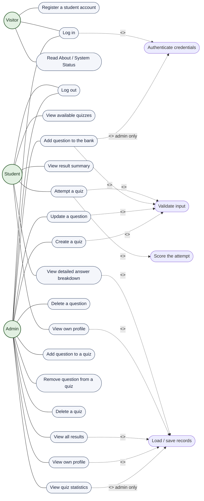

# Use Case Diagram — QuizMaster

> Machine-readable source: the Mermaid block below. It renders directly on
> GitHub, GitLab, VS Code (Markdown Preview Mermaid Support) and on
> <https://mermaid.live>.

---

## 1. Actors

| Actor | Description | Reached through |
| --- | --- | --- |
| **Visitor** | Anyone who starts the program but is not signed in. Can create a student account, sign in, read the About box and the System Status report. | `Student::showPortalGate()`, `main()` menu |
| **Student** | A registered examination candidate. May attempt quizzes, see only *their own* results, and view their own profile. | `Student::showMenu()` |
| **Admin** | The content owner. Manages the question bank and quizzes and may inspect every student's result and the class statistics. Created automatically on first run (`admin` / `admin123`). | `Admin::showMenu()` |

`User` is the common abstract superclass of *Student* and *Admin*. After a
successful `User::login()` the program keeps a `User*` and calls
`showMenu()` through that base pointer, so the same two virtual calls
(`getRole()`, `showMenu()`) produce a completely different menu depending on the
concrete object — this is the polymorphism the project is built around.

---

## 2. Use case specifications

The eight specifications below group the twenty ovals of the diagram, so a marker can
read the table while pointing at one node:

| Specification | Diagram nodes |
| --- | --- |
| UC-01 Register a student account | `UC1` |
| UC-02 Log in | `UC2` (+ `UCA`) |
| UC-03 Attempt a quiz | `UC5`, `UC6` (+ `UCV`, `UCS`) |
| UC-04 View results | `UC7`, `UC8` (+ `UCL`) |
| UC-05 Add / update / delete a question | `UC10`, `UC11`, `UC12` (+ `UCV`) |
| UC-06 Create and maintain a quiz | `UC13`, `UC14`, `UC15`, `UC16` (+ `UCV`) |
| UC-07 View all results and statistics | `UC17`, `UC18` (+ `UCL`) |
| UC-08 Log out | `UC4` |

`UC3` (About / System Status) and `UC9` / `UC19` (view own profile) are read-only
screens that need no separate specification.

### UC-01 Register a student account

| | |
| --- | --- |
| **Primary actor** | Visitor |
| **Pre-condition** | `data/users.txt` exists (created automatically if missing). |
| **Post-condition** | A new `Student` is appended to `users.txt` with a hashed password and a generated id (`STU003`, `STU004`, …). |
| **Main flow** | 1. Visitor chooses *Register* on the portal gate. 2. System asks for full name, username, password and confirm-password. 3. `UI::readNonEmpty()` rejects an empty or non-alphanumeric name/username. 4. `User::usernameExists()` rejects a duplicate username. 5. Password must be ≥ 4 characters (`PASSWORD_MIN_LENGTH` in `src/Student.cpp`) and both entries must match. 6. `User::appendRecord()` writes the new record. 7. Success message with the generated student id. |
| **Alternate flow** | 3–5. Any rule broken → inline warning, the same field is asked again, nothing is written. |
| **Implemented by** | `Student::registerStudent()`, `Student::handleRegistration()` |

### UC-02 Log in

| | |
| --- | --- |
| **Primary actor** | Visitor (becomes Student or Admin) |
| **Pre-condition** | The account exists in `users.txt`. |
| **Post-condition** | The session flag is set, the correct derived object is created and its dashboard/menu is shown. |
| **Main flow** | 1. Actor enters username and password (masked by `UI::readPassword()`). 2. `User::loadRecords()` reads every record, skipping malformed lines. 3. The matching record is found and `hashPassword()` is compared. 4. A `Student` or an `Admin` object is constructed from the record. 5. `showMenu()` is dispatched polymorphically. |
| **Alternate flow** | 3. No match or wrong hash → *Invalid username or password*, back to step 1. |
| **Implemented by** | `User::login()`, `Student::handleLogin()`, `Admin::showLoginScreen()` |

### UC-03 Attempt a quiz

| | |
| --- | --- |
| **Primary actor** | Student |
| **Pre-condition** | Logged in; at least one quiz with at least one question exists. |
| **Post-condition** | A new `Result` row is appended to `results.txt`. |
| **Main flow** | 1. Student picks a quiz from the available list. 2. `Quiz::startQuiz()` shows every question with options A–D. 3. `Question::normalizeAnswer()` converts the input to upper case and rejects anything outside `A..D`. 4. An `AnswerRecord{questionId, chosen, correct}` is stored per question. 5. `Result::calculateScore()` derives correct answers, score, percentage and grade. 6. The detailed table and the saved-result confirmation are printed. |
| **Alternate flow** | 3. Invalid answer → warning, the same question is asked again. 2. Empty quiz → the quiz is reported as not available yet. |
| **Implemented by** | `Student::attemptQuiz()`, `Student::runQuizSession()`, `Quiz::startQuiz()`, `Result::calculateScore()` |

### UC-04 View results

| | |
| --- | --- |
| **Primary actor** | Student |
| **Pre-condition** | Logged in. |
| **Main flow (summary)** | 1. `Result::loadAll()` reads every result. 2. Only rows whose `studentId` matches the session are kept. 3. Attempt number, quiz, score, percentage, grade and pass/fail are tabulated. 4. The student selects one attempt → per-question chosen vs correct answer. |
| **Alternate flow** | No rows for this student → *You have not attempted any quiz yet.* |
| **Implemented by** | `Student::viewResults()`, `Student::selectResult()`, `Student::displayDetailedResult()`, `Result::getDetailedRows()` |

### UC-05 Add / update / delete a question

| | |
| --- | --- |
| **Primary actor** | Admin |
| **Pre-condition** | Logged in as admin; `Admin::loadData()` has filled `questionBank`. |
| **Main flow (add)** | 1. Admin enters the question text, four options and the correct answer. 2. The form is validated (non-empty text, non-empty options, answer in `A..D`). 3. `Question::nextQuestionId()` allocates the id and `Question::saveAll()` rewrites the bank atomically through a `.tmp` file. |
| **Main flow (update)** | The admin picks a question by id; every field is offered with the current value as default; the quiz copies of that question are refreshed so every quiz stays consistent. |
| **Main flow (delete)** | The admin picks a question by id, confirms, and the question is removed from the bank **and** from every quiz that used it. |
| **Implemented by** | `Admin::addQuestion()`, `Admin::updateQuestion()`, `Admin::deleteQuestion()` |

### UC-06 Create and maintain a quiz

| | |
| --- | --- |
| **Primary actor** | Admin |
| **Main flow (create)** | 1. Admin enters a title and a description. 2. `Quiz::nextQuizId()` allocates the id and `Quiz::saveAll()` persists the header. |
| **Main flow (add / remove question)** | The admin picks a quiz, then picks a question from the bank; `Quiz::addQuestion()` stores a **copy** of the question (composition), so later edits to the bank can be pushed into all quizzes that use it. |
| **Main flow (delete quiz)** | Confirmation, then the quiz header line and all of its question lines are removed from `quizzes.txt`. The stored results are deliberately kept. |
| **Implemented by** | `Admin::createQuiz()`, `Admin::addQuestionToQuiz()`, `Admin::removeQuestionFromQuiz()`, `Admin::deleteQuiz()` |

### UC-07 View all results and statistics

| | |
| --- | --- |
| **Primary actor** | Admin |
| **Main flow** | 1. `Result::loadAll()` loads every stored attempt of every student. 2. A per-quiz table lists attempts, average score, highest score, lowest score and pass percentage. 3. Overall totals (students, quizzes, attempts, average, pass rate) and a per-student summary are printed. |
| **Implemented by** | `Admin::viewResults()`, `Admin::quizStatistics()` |

### UC-08 Log out

| | |
| --- | --- |
| **Primary actor** | Student, Admin |
| **Main flow** | `User::logout()` clears the session flag, the polymorphic object is destroyed and the program returns to the main menu. Pending in-memory changes of an admin are saved before the object goes away. |

---

## 3. Cross-cutting use cases

| Use case | Included by | Why |
| --- | --- | --- |
| **Validate input** `UCV` | register, attempt quiz, add/update question, create quiz | Every numeric, choice and non-empty read goes through `UI::readInt()`, `UI::readChoice()`, `UI::readNonEmpty()` and `UI::readPassword()`, so no domain class ever parses `std::cin` itself. |
| **Authenticate credentials** `UCA` | log in (and every admin-only use case) | Passwords are compared as FNV-1a 64-bit hashes produced by `User::hashPassword()`; plaintext is never stored. |
| **Score the attempt** `UCS` | attempt a quiz | `Result::calculateScore()` is the single place where marks, percentage and grade are derived. |
| **Load / save records** `UCL` | view results, statistics, profile, question/quiz management | All disk access is funnelled through `FileStore`, which escapes `|` and `\` and rewrites files atomically via a `.tmp` file. |

---

## 4. Business rules enforced

1. A username is unique across the whole system and must be alphanumeric.
2. A password is at least 4 characters (`PASSWORD_MIN_LENGTH`) and must be typed twice identically.
3. Passwords are stored only as FNV-1a hashes — never in clear text.
4. A student may only see results whose `studentId` equals the logged-in id.
5. Only an `Admin` object can reach question/quiz management; the check happens
   through `getRole()` on the base-class pointer.
6. A question needs non-empty text, four non-empty options and a correct answer
   in `A..D`.
7. A quiz needs a non-empty title before it can be saved.
8. A quiz with zero questions cannot be attempted.
9. Deleting a question also removes it from every quiz that contained it.
10. Every finished attempt is appended to `results.txt` exactly once.
11. Percentage is `score * 100.0 / total`, rounded to two decimals; pass mark is 40 %.